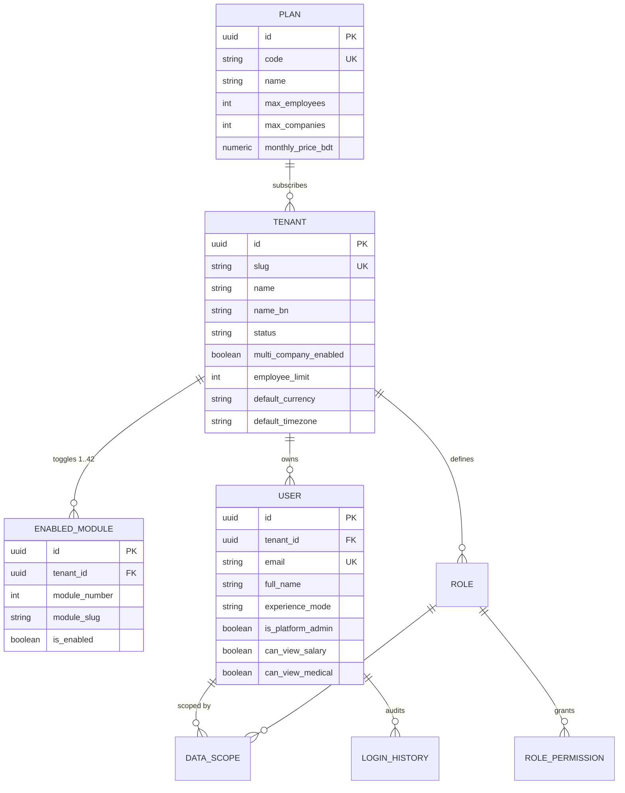
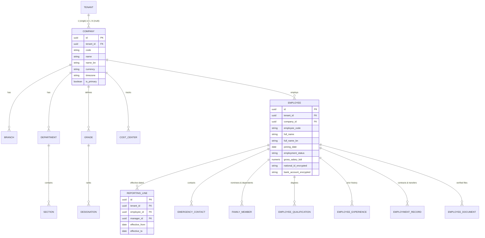
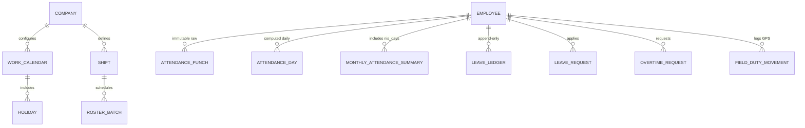
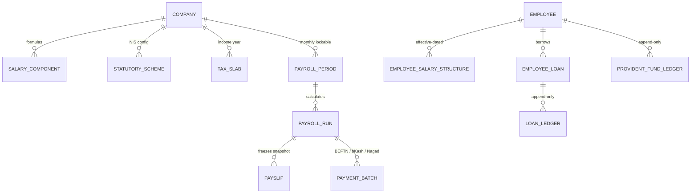
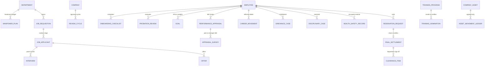
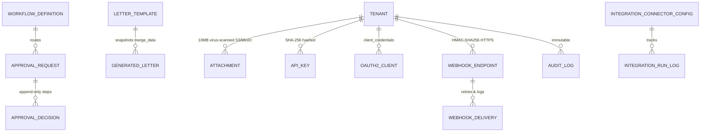

# Database Entity-Relationship (ER) Diagrams by Module Group

All tenant-owned tables inherit from `TenantModel` (`id` UUIDv7, `tenant_id` FK with composite index, `is_active`, `created_at`, `updated_at`, `created_by`, `updated_by`, `deleted_at`).

---

## 1. Platform & Identity Group (Phase 0 & Module 39, 40)

---

## 2. Organization & Employee Group (Phase 1: Modules 2 & 3)

---

## 3. Time & Presence Group (Phase 2: Modules 8, 9, 10, 11, 12, 13)

---

## 4. Payroll & Compensation Group (Phase 3: Modules 14–22)

---

## 5. Talent Lifecycle, Relations, Assets & Exit Group (Phases 4 & 5: Modules 4–7, 23–31, 34)

---

## 6. Governance, Workflows & Integrations Group (Modules 35–38, 40–42)

